<!-- Built by scripts/build.mjs from scripts/README.tpl.md. Edit the template, not this file. -->

<a href="https://developer.satelit.md/en/">
  <picture>
    <source media="(prefers-color-scheme: dark)" srcset="https://raw.githubusercontent.com/Satelit-Moldova/.github/86c2dc5336406a47837a1074e46936fe7c683183/profile/assets/banner-dark.svg?v=86c2dc5">
    
  </picture>
</a>

<p align="center">
  <a href="https://developer.satelit.md/en/docs/"><b>Docs</b></a> &nbsp;·&nbsp;
  <a href="https://developer.satelit.md/en/reference/"><b>API reference</b></a> &nbsp;·&nbsp;
  <a href="https://developer.satelit.md/en/pricing/"><b>Pricing</b></a> &nbsp;·&nbsp;
  <a href="https://developer.satelit.md/en/console/"><b>Get a key</b></a> &nbsp;·&nbsp;
  <a href="https://developer.satelit.md/en/mcp/"><b>MCP for AI assistants</b></a> &nbsp;·&nbsp;
  <a href="https://developer.satelit.md/en/sdks-plugins/"><b>All SDKs and plugins</b></a>
</p>

Moldova publishes its data in a hundred places, in a hundred formats. Satelit reads them every day and gives you one API. Prices from 88 online shops, BNM exchange rates, fuel prices from 82 networks, court hearings, the company register, laws back to 1961, news, cinemas and films. One key, clean JSON, four languages.

<a href="https://developer.satelit.md/en/data/">
  <picture>
    <source media="(prefers-color-scheme: dark)" srcset="https://raw.githubusercontent.com/Satelit-Moldova/.github/86c2dc5336406a47837a1074e46936fe7c683183/profile/assets/today-dark.svg?v=86c2dc5">
    
  </picture>
</a>

<sub>This card refreshes itself every few hours from the live API. So do the numbers below.</sub>

## Try it in ten seconds

<p>
<a href="https://github.com/Satelit-Moldova/satelit-js"><picture><source media="(prefers-color-scheme: dark)" srcset="https://raw.githubusercontent.com/Satelit-Moldova/.github/86c2dc5336406a47837a1074e46936fe7c683183/profile/assets/code-dark.svg?v=86c2dc5">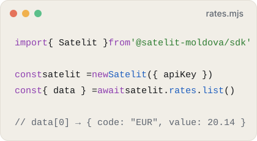</picture></a>
<a href="https://github.com/Satelit-Moldova/satelit-go"><picture><source media="(prefers-color-scheme: dark)" srcset="https://raw.githubusercontent.com/Satelit-Moldova/.github/86c2dc5336406a47837a1074e46936fe7c683183/profile/assets/terminal-dark.svg?v=86c2dc5"></picture></a>
</p>

No key needed for a first look. Every answer also tells you what it cost and what is left, in the `X-Credits-*` headers.

```bash
curl https://api.satelit.md/v1/sample
```

<picture>
  <source media="(prefers-color-scheme: dark)" srcset="https://raw.githubusercontent.com/Satelit-Moldova/.github/86c2dc5336406a47837a1074e46936fe7c683183/profile/assets/numbers-dark.svg?v=86c2dc5">
  
</picture>

## SDKs

<p>
<a href="https://github.com/Satelit-Moldova/satelit-js"><picture><source media="(prefers-color-scheme: dark)" srcset="https://raw.githubusercontent.com/Satelit-Moldova/.github/86c2dc5336406a47837a1074e46936fe7c683183/profile/assets/repo-satelit-js-dark.svg?v=86c2dc5"></picture></a>
<a href="https://github.com/Satelit-Moldova/satelit-python"><picture><source media="(prefers-color-scheme: dark)" srcset="https://raw.githubusercontent.com/Satelit-Moldova/.github/86c2dc5336406a47837a1074e46936fe7c683183/profile/assets/repo-satelit-python-dark.svg?v=86c2dc5"></picture></a>
<a href="https://github.com/Satelit-Moldova/satelit-go"><picture><source media="(prefers-color-scheme: dark)" srcset="https://raw.githubusercontent.com/Satelit-Moldova/.github/86c2dc5336406a47837a1074e46936fe7c683183/profile/assets/repo-satelit-go-dark.svg?v=86c2dc5"></picture></a>
<a href="https://github.com/Satelit-Moldova/satelit-php"><picture><source media="(prefers-color-scheme: dark)" srcset="https://raw.githubusercontent.com/Satelit-Moldova/.github/86c2dc5336406a47837a1074e46936fe7c683183/profile/assets/repo-satelit-php-dark.svg?v=86c2dc5"></picture></a>
</p>

## Plugins for the sites Moldova already runs on

Most Moldovan shops, city halls, schools and newsrooms run on WordPress, OpenCart, PrestaShop, Joomla or Drupal. Each plugin installs from the admin panel, keeps the key on the server and caches every answer.

<p>
<a href="https://github.com/Satelit-Moldova/satelit-wordpress"><picture><source media="(prefers-color-scheme: dark)" srcset="https://raw.githubusercontent.com/Satelit-Moldova/.github/86c2dc5336406a47837a1074e46936fe7c683183/profile/assets/repo-satelit-wordpress-dark.svg?v=86c2dc5"></picture></a>
<a href="https://github.com/Satelit-Moldova/satelit-opencart"><picture><source media="(prefers-color-scheme: dark)" srcset="https://raw.githubusercontent.com/Satelit-Moldova/.github/86c2dc5336406a47837a1074e46936fe7c683183/profile/assets/repo-satelit-opencart-dark.svg?v=86c2dc5"></picture></a>
<a href="https://github.com/Satelit-Moldova/satelit-prestashop"><picture><source media="(prefers-color-scheme: dark)" srcset="https://raw.githubusercontent.com/Satelit-Moldova/.github/86c2dc5336406a47837a1074e46936fe7c683183/profile/assets/repo-satelit-prestashop-dark.svg?v=86c2dc5"></picture></a>
<a href="https://github.com/Satelit-Moldova/satelit-joomla"><picture><source media="(prefers-color-scheme: dark)" srcset="https://raw.githubusercontent.com/Satelit-Moldova/.github/86c2dc5336406a47837a1074e46936fe7c683183/profile/assets/repo-satelit-joomla-dark.svg?v=86c2dc5"></picture></a>
<a href="https://github.com/Satelit-Moldova/satelit-drupal"><picture><source media="(prefers-color-scheme: dark)" srcset="https://raw.githubusercontent.com/Satelit-Moldova/.github/86c2dc5336406a47837a1074e46936fe7c683183/profile/assets/repo-satelit-drupal-dark.svg?v=86c2dc5"></picture></a>
</p>

## Ready to run

<p>
<a href="https://github.com/Satelit-Moldova/satelit-cinema"><picture><source media="(prefers-color-scheme: dark)" srcset="https://raw.githubusercontent.com/Satelit-Moldova/.github/86c2dc5336406a47837a1074e46936fe7c683183/profile/assets/repo-satelit-cinema-dark.svg?v=86c2dc5"></picture></a>
<a href="https://github.com/Satelit-Moldova/satelit-widgets"><picture><source media="(prefers-color-scheme: dark)" srcset="https://raw.githubusercontent.com/Satelit-Moldova/.github/86c2dc5336406a47837a1074e46936fe7c683183/profile/assets/repo-satelit-widgets-dark.svg?v=86c2dc5"></picture></a>
<a href="https://github.com/Satelit-Moldova/satelit-examples"><picture><source media="(prefers-color-scheme: dark)" srcset="https://raw.githubusercontent.com/Satelit-Moldova/.github/86c2dc5336406a47837a1074e46936fe7c683183/profile/assets/repo-satelit-examples-dark.svg?v=86c2dc5"></picture></a>
</p>

## Why teams pick it

- Every repository here ran against the live API before it was published. The versions it was tested on are in its README.
- Most calls cost 1 to 5 credits, and the plugins cache answers. A busy site spends little.
- Keys never reach a browser. Every answer names its sources and carries the attribution each source asks for.
- Add `?lang=ro`, `ru`, `en` or `uk` to any call and the labels come back in that language.

## Pe scurt

Satelit adună datele publice ale Moldovei într-un singur API: prețuri din magazine, cursul BNM, carburanți, instanțe, companii, legi, știri, cinematografe. Aici găsiți SDK-uri pentru JavaScript, Python, Go și PHP, pluginuri pentru WordPress, OpenCart, PrestaShop, Joomla și Drupal, un site de cinema gata făcut și exemple. Cheia se face în [consolă](https://developer.satelit.md/ro/consola/). Întrebări: contact@satelit.md.

<sub>MIT licence for all code here. Data terms per source: [licence](https://developer.satelit.md/en/licence/). Security reports: contact@satelit.md.</sub>
